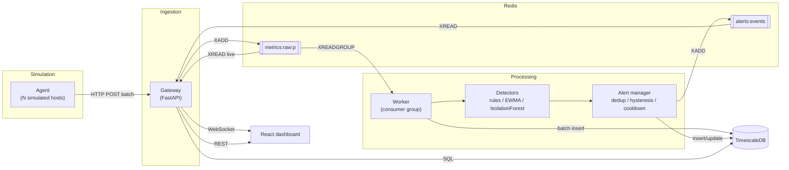

# Architecture — Metrics Anomaly Engine

> Fuente de verdad del diseño. Cualquier cambio requiere un ADR aprobado (`docs/adr/`).
> Identificadores en inglés; explicaciones en español.

---

## 1. Visión general



**Principios:**
1. Todo dato recibido se persiste, sin importar la detección.
2. Los detectores corren en paralelo sobre todo el stream; ninguno filtra la entrada de otro.
3. Entrega *at-least-once* + escritura idempotente = sin pérdida ni duplicados.
4. La detección es código puro, reutilizable online y offline.

---

## 2. Estructura del repositorio

```text
metrics-anomaly-engine/
├── CLAUDE.md
├── PROMPTS.md
├── README.md
├── Makefile
├── docker-compose.yml
├── .env.example
├── .github/workflows/ci.yml
├── db/
│   └── init/                    # SQL ejecutado al crear el contenedor
│       ├── 001_extensions.sql
│       ├── 002_metrics.sql
│       └── 003_alerts.sql
├── docs/
│   ├── ARCHITECTURE.md
│   ├── benchmarks.md            # generado por `make eval` y `make load`
│   ├── adr/
│   └── learning/
├── backend/
│   ├── pyproject.toml
│   ├── .python-version          # versión de Python para uv (ADR-000)
│   ├── uv.lock                  # versiones exactas de dependencias (ADR-000)
│   ├── Dockerfile               # una imagen, varios comandos
│   ├── models/                  # artefactos .joblib (gitignored excepto README)
│   ├── src/engine/
│   │   ├── config.py            # pydantic-settings
│   │   ├── schemas.py           # contratos Pydantic compartidos
│   │   ├── logging.py
│   │   ├── redis_keys.py        # nombres de streams y particiones
│   │   ├── db/                  # pool asyncpg, queries
│   │   ├── gateway/
│   │   │   ├── app.py
│   │   │   ├── routes/          # ingest.py, query.py, health.py
│   │   │   ├── services/
│   │   │   └── live.py          # broadcaster WebSocket
│   │   ├── worker/
│   │   │   ├── main.py
│   │   │   ├── consumer.py      # XREADGROUP, XACK, XAUTOCLAIM, DLQ
│   │   │   ├── persistence.py
│   │   │   ├── pipeline.py      # orquesta ventanas + detectores + alertas
│   │   │   └── alerting.py      # alert manager (con estado)
│   │   ├── detection/           # PURO: sin I/O
│   │   │   ├── base.py          # protocolo Detector, tipos de resultado
│   │   │   ├── window.py        # ventana deslizante por host
│   │   │   ├── rules.py
│   │   │   ├── ewma.py
│   │   │   ├── features.py
│   │   │   └── iforest.py
│   │   ├── simulation/          # PURO y determinista
│   │   │   ├── profiles.py
│   │   │   ├── anomalies.py
│   │   │   └── generator.py
│   │   ├── agent/
│   │   │   └── __main__.py      # CLI (`python -m engine.agent`): envía la simulación al gateway
│   │   └── ml/
│   │       ├── train.py
│   │       └── evaluate.py
│   └── tests/
│       ├── unit/
│       └── integration/
├── scripts/
│   └── loadtest.py
└── frontend/
    ├── Dockerfile
    ├── package.json
    └── src/
        ├── api/                 # cliente REST + tipos
        ├── hooks/               # useLiveStream, useMetricsHistory
        ├── components/
        │   ├── ui/
        │   ├── metrics/
        │   └── alerts/
        └── pages/Dashboard.tsx
```

---

## 3. Componentes

### 3.1 Simulation (`engine/simulation`)
- **Perfiles de host:** `web`, `db`, `batch`. Cada uno con niveles base distintos, un patrón cíclico (sinusoide de periodo configurable, por defecto 10 min, para simular un ciclo diario comprimido) y ruido gaussiano.
- **Anomalías inyectables** (cada una genera un registro de *ground truth* `{host, type, start, end}`):

| Tipo | Métrica | Forma |
|---|---|---|
| `cpu_spike` | cpu_pct | salto a 96–100 % durante 10–30 s |
| `memory_leak` | mem_pct | crecimiento lineal lento (p. ej. +0.05 %/s) hasta 95 % |
| `latency_shift` | latency_ms | cambio de nivel ×3 sostenido |
| `traffic_drop` | rps | caída a < 5 % del normal |
| `variance_burst` | latency_ms | varianza ×5 con media igual |

- Determinista: mismo `seed` = misma serie y mismo ground truth.
- Se usa en dos lugares: el agente (en vivo) y `ml/evaluate.py` (offline, sin red).

### 3.2 Agent (`engine/agent`)
- CLI: `python -m engine.agent --hosts 5 --interval 1.0 --scenario demo|normal|load --seed 42 --gateway-url http://gateway:8000`.
- Agrupa las lecturas de cada tick en un batch y hace `POST /v1/metrics`.
- Reintentos con backoff exponencial y jitter; buffer acotado (descarta lo más viejo y lo cuenta si se llena).
- Opcional (extensión): `--source psutil` para enviar métricas reales de tu máquina.

### 3.3 Gateway (`engine/gateway`)
- Valida, asigna `ingested_at` y hace `XADD` a la partición `metrics:raw:{hash(host) % STREAM_PARTITIONS}` con `MAXLEN ~ STREAM_MAXLEN`.
- Responde `202 Accepted`. Si Redis no está disponible, responde `503`.
- Sirve la API de lectura (REST), el WebSocket en vivo y `/metrics` (Prometheus).

### 3.4 Worker (`engine/worker`)
Loop por partición asignada (`WORKER_PARTITIONS`, p. ej. `0` o `0,1`):

1. `XREADGROUP GROUP detectors <consumer> COUNT 500 BLOCK 1000`.
2. Parsea y valida. Los mensajes inválidos van a `metrics:dlq` y se confirman.
3. **Batch insert idempotente** en `metrics` (`ON CONFLICT (host, time) DO NOTHING`).
4. Actualiza la ventana deslizante de cada host y ejecuta los detectores.
5. Pasa los resultados al alert manager; las alertas nuevas o resueltas se guardan en `alerts` y se publican en `alerts:events`.
6. `XACK` **solo después** del paso 3 (y del 5 si hubo alertas).
7. Cada 30 s: `XAUTOCLAIM` de mensajes pendientes con más de 60 s de inactividad. Si un mensaje supera 5 entregas, va a `metrics:dlq` y se confirma.

**Arranque:** reconstruye las ventanas leyendo de la BD las últimas `WINDOW_SIZE` muestras por host, y el estado de las alertas `firing`.
**Apagado:** maneja SIGTERM y termina el batch en curso antes de salir.

**Escalado:** como las ventanas viven en memoria por host, todos los mensajes de un host deben ir al mismo worker. Por eso el stream se particiona por host y cada worker se queda con particiones fijas. Con `STREAM_PARTITIONS=1` hay un solo worker.

---

## 4. Contratos de datos (`engine/schemas.py`)

### 4.1 Métrica
```json
{
  "host": "web-01",
  "ts": "2026-11-08T20:00:00.000Z",
  "cpu_pct": 37.2,
  "mem_pct": 61.0,
  "latency_ms": 120.5,
  "rps": 340.0
}
```
Validación: `host` con patrón `^[a-z0-9-]{1,64}$`; `cpu_pct` y `mem_pct` en [0, 100]; `latency_ms` y `rps` ≥ 0; `ts` con zona horaria, a lo sumo 5 min en el futuro.

### 4.2 Ingesta
`POST /v1/metrics` con body `{"metrics": [Metric, ...]}` (1 a 1000 ítems) → `202 {"accepted": n}`.

### 4.3 Entrada en Redis Stream
Campos: `payload` (Metric en JSON) e `ingested_at_ms` (epoch ms, para medir latencia de extremo a extremo).

### 4.4 Alerta
```json
{
  "alert_id": "uuid",
  "host": "web-01",
  "metric": "mem_pct",
  "detector": "rules | ewma | iforest",
  "severity": "INFO | WARNING | CRITICAL",
  "state": "firing | resolved",
  "score": 0.73,
  "message": "mem_pct trending up: slope 0.05%/s over 60s",
  "started_at": "...",
  "updated_at": "...",
  "resolved_at": null
}
```
Para `iforest`, `metric` = `"multivariate"`.

---

## 5. Redis

| Clave | Tipo | Uso |
|---|---|---|
| `metrics:raw:{p}` | Stream | Métricas entrantes, partición `p`. `MAXLEN ~ 1_000_000` |
| `metrics:dlq` | Stream | Mensajes inválidos o con demasiados reintentos |
| `alerts:events` | Stream | Cambios de estado de alertas. `MAXLEN ~ 10_000` |

Consumer group: `detectors`. Nombre del consumer: `{hostname}-{pid}`.

---

## 6. Base de datos (TimescaleDB)

### `metrics` (hypertable sobre `time`, chunks de 1 día)
| Columna | Tipo |
|---|---|
| time | timestamptz NOT NULL |
| host | text NOT NULL |
| cpu_pct, mem_pct, latency_ms, rps | double precision NOT NULL |
| PK | (host, time) |

- Continuous aggregate `metrics_1m`: avg y max por host y minuto.
- Retención: crudo 7 días, `metrics_1m` 90 días.

### `alerts`
| Columna | Tipo |
|---|---|
| alert_id | uuid PK |
| host, metric, detector, severity, state, message | text |
| score | double precision |
| started_at, updated_at | timestamptz NOT NULL |
| resolved_at | timestamptz NULL |

Índices: `(state, updated_at DESC)`, `(host, started_at DESC)`.

---

## 7. Detección (`engine/detection`)

Interfaz común:
```python
class Detector(Protocol):
    name: str
    def evaluate(self, host: str, window: HostWindow) -> list[DetectionResult]: ...
```
`DetectionResult`: `host`, `metric`, `detector`, `is_anomaly`, `score`, `severity`, `message`, `ts`.

Los tres detectores corren **en paralelo** sobre cada muestra (iforest cada `IFOREST_EVAL_EVERY` muestras).

### 7.1 Rules
| Condición | Severidad |
|---|---|
| cpu_pct > 95 | CRITICAL |
| mem_pct > 90 | CRITICAL |
| latency_ms > 1000 | WARNING |
| rps < 1 durante 10 muestras seguidas | WARNING |
Umbrales configurables.

### 7.2 EWMA (baseline estadístico)
- Media y varianza EWMA por host y métrica (`alpha` configurable, por defecto 0.05).
- z-score = (x − μ) / σ. |z| > 4 → WARNING.
- *Warm-up*: sin alertas en las primeras 60 muestras.
- Es el **baseline** contra el que se compara el ML.

### 7.3 Isolation Forest
- Ventana de `WINDOW_SIZE = 60` muestras por host.
- Features por cada una de las 4 métricas: `mean`, `std`, `slope` (regresión lineal sobre la ventana), `last_z` (última muestra vs. media y std de la ventana), `min`, `max` → 24 features.
- Entrenado solo con datos normales (`make train`, seed fija). El artefacto guarda modelo, lista de features, versión, fecha, seed y umbral calibrado.
- Umbral: percentil del score sobre un set de validación normal (p. ej. falsos positivos ≤ 1 %).
- Si el artefacto no existe, el worker sigue sin este detector y lo loguea.

### 7.4 Alert manager (`worker/alerting.py`)
Clave de estado: `(host, metric, detector)`.
- **Disparo:** `FIRE_AFTER` evaluaciones anómalas seguidas (1 para CRITICAL de reglas, 3 para el resto).
- **Resolución:** `RESOLVE_AFTER = 10` evaluaciones normales seguidas (histéresis).
- **Cooldown:** 5 min antes de volver a disparar la misma clave.
- **Dedup:** mientras está `firing`, solo se actualiza `updated_at` y `score`; no se crean alertas nuevas.

---

## 8. Evaluación offline (`ml/evaluate.py`)

- Genera escenarios con `engine.simulation` (seed fija, sin red ni BD) y ejecuta los detectores directamente.
- **Métrica a nivel de evento:** un evento inyectado cuenta como detectado si hay una alerta del mismo host que se solapa con `[start, end + 60 s]`. Una alerta que no se solapa con ningún evento es un falso positivo.
- Reporta, por detector (rules, ewma, iforest, combinado) y por tipo de anomalía: precision, recall, F1 y mediana del tiempo de detección.
- Escribe `docs/benchmarks.md` (tablas) y `docs/img/*.png` (gráficas). **Los resultados se reportan tal como salen, incluso si el ML no supera al baseline.**

---

## 9. API del gateway

| Método | Ruta | Descripción |
|---|---|---|
| POST | `/v1/metrics` | Ingesta (batch) |
| GET | `/v1/hosts` | Hosts vistos en los últimos 15 min |
| GET | `/v1/metrics/query?host=&from=&to=&resolution=raw\|1m` | Histórico |
| GET | `/v1/alerts?state=&host=&limit=` | Alertas |
| WS | `/v1/live` | Stream en vivo |
| GET | `/healthz` | Proceso vivo |
| GET | `/readyz` | Redis y BD accesibles |
| GET | `/metrics` | Prometheus |

### Protocolo WebSocket
- Cliente → servidor: `{"type": "subscribe", "hosts": ["web-01"]}` (lista vacía = todos).
- Servidor → cliente: `{"type": "metric", "data": Metric}` y `{"type": "alert", "data": Alert}`.
- El servidor envía `ping` cada 20 s. El cliente reconecta con backoff exponencial.

---

## 10. Observabilidad propia (Prometheus)

| Métrica | Servicio |
|---|---|
| `ingest_requests_total{status}`, `ingest_metrics_total`, `ingest_request_seconds` | gateway |
| `worker_messages_processed_total`, `worker_batch_seconds` | worker |
| `pipeline_e2e_latency_seconds` (ahora − `ingested_at_ms`) | worker |
| `worker_pending_messages{partition}` | worker |
| `alerts_emitted_total{detector,severity}` | worker |
| `dlq_messages_total` | worker |

Worker expone métricas en `:9100/metrics`.

---

## 11. Configuración (`.env.example`)

`REDIS_URL`, `DATABASE_URL`, `STREAM_PARTITIONS`, `STREAM_MAXLEN`, `WORKER_PARTITIONS`, `WINDOW_SIZE`, `IFOREST_EVAL_EVERY`, `MODEL_PATH`, `CORS_ORIGINS`, `LOG_LEVEL`.

Solo para el contenedor de TimescaleDB en Docker Compose: `POSTGRES_USER`, `POSTGRES_PASSWORD`, `POSTGRES_DB`.

Puertos: gateway 8000, worker 9100, frontend 8080, postgres 5432, redis 6379, (opcional) prometheus 9090, grafana 3000.

---

## 12. Modos de fallo

| Fallo | Comportamiento |
|---|---|
| Worker muere a mitad de un batch | Mensajes quedan pendientes; `XAUTOCLAIM` los reasigna; el insert idempotente evita duplicados; ventanas y alertas se reconstruyen al arrancar. |
| Redis caído | Gateway responde 503; el agente reintenta con backoff y buffer acotado. |
| BD caída | El worker no confirma; reintenta con backoff; el stream acumula; `/readyz` falla. |
| Mensaje malformado | Va a `metrics:dlq` y se cuenta. |
| Consumer lento | Crece `worker_pending_messages`; el stream se recorta con `MAXLEN ~`. |
| Falta el modelo | El worker corre sin iforest y lo indica en logs. |

---

## 13. Fuera de alcance (non-goals)

Autenticación multiusuario, Kubernetes, agentes reales en producción, múltiples tenants, alta disponibilidad de Redis/Postgres. Se pueden mencionar como trabajo futuro en el README.
